# ClubConnect — Automated CI/CD Deployment Guide

This document describes the automated deployment architecture, workflows, server management, database backup/restore procedures, rollback strategies, and operational runbooks for **ClubConnect**.

---

## 1. Architecture & Infrastructure Overview

### Environments

| Environment | Hostname | Target OS | Port Binding | Compose Project | Database |
| :--- | :--- | :--- | :--- | :--- | :--- |
| **Staging** | `CC-NPR` | Ubuntu 26.04.1 LTS (ARM64) | `127.0.0.1:8088:80` | `clubconnect-staging` | `clubconnect_staging` |
| **Production** | Dedicated Host | Ubuntu LTS (ARM64/x64) | `127.0.0.1:8080:80` | `clubconnect-production` | `clubconnect_production` |

### Server Directory Layout (`/opt/clubconnect`)

On deployment targets, the application is organized under `/opt/clubconnect` owned by the `deploy` user:

```text
/opt/clubconnect/
├── compose.staging.yml         # Baseline Staging Docker Compose file
├── compose.production.yml      # Baseline Production Docker Compose file
├── config/
│   ├── .env.staging            # Staging environment secrets & credentials (chmod 600)
│   └── .env.production         # Production environment secrets & credentials (chmod 600)
├── releases/                   # Versioned deployment directory & release metadata
│   ├── <commit-sha>/           # Uploaded scripts & compose templates for release
│   │   ├── scripts/
│   │   └── deploy/
│   ├── staging_current.release # Active release metadata for staging
│   ├── staging_previous.release# Prior release metadata for staging rollback
│   ├── staging_validated_digests.txt # Audit list of digests verified on staging
│   └── history.log             # Full audit log of all deployments & rollbacks
├── backups/                    # Automated PostgreSQL custom-format (-Fc) dumps (chmod 600)
│   └── clubconnect_staging_YYYYMMDD_HHMMSSZ.dump
└── scripts/                    # Baseline administrative scripts
```

> [!IMPORTANT]
> - **Zero-Overwriting Synchronization:** Deployment synchronization never overwrites protected directories (`backups/`, `config/`, or persistent PostgreSQL volumes).
> - **Versioned Manifests:** All scripts and deployment manifests are placed in `/opt/clubconnect/releases/<commit-sha>/` and executed directly from the release directory.
> - **Environment Protection:** Every Docker Compose operation explicitly passes `--env-file` pointing to `/opt/clubconnect/config/.env.<env>`, preventing default fallback issues and ensuring secrets are never logged.

---

## 2. GitHub Actions Secrets Configuration

Configure the following secrets in the GitHub repository or environment settings:

### Staging Environment Secrets (`staging`)
- `DEPLOY_HOST`: Staging server IP or DNS name (e.g. Hetzner `CC-NPR`).
- `DEPLOY_USER`: Deployment user (e.g. `deploy`).
- `DEPLOY_SSH_KEY`: Ed25519 private key authorized on `CC-NPR` in `/home/deploy/.ssh/authorized_keys`.
- `DEPLOY_KNOWN_HOSTS`: Pinned host public key (e.g. output of `ssh-keyscan -H <DEPLOY_HOST>`).

### Production Environment Secrets (`production`)
- `PROD_DEPLOY_HOST`: Production server IP or DNS name.
- `PROD_DEPLOY_USER`: Production deployment user (`deploy`).
- `PROD_DEPLOY_SSH_KEY`: Ed25519 private key authorized on the production server.
- `PROD_DEPLOY_KNOWN_HOSTS`: Production server host key entry.

---

## 3. Deployment Workflow & Safety Gates

### Manual Deployment via GitHub Actions (Initial & Rollout Mode)

1. Open the repository on GitHub and navigate to **Actions** → **ClubConnect Deploy**.
2. Click **Run workflow**.
3. Select parameters:
   - **Target deployment environment:** `staging` or `production`
   - **Commit SHA to deploy:** (Optional) Enter a specific full commit SHA, or leave blank to deploy the latest commit.
   - **Confirm production:** Required for production deployments (enter `CONFIRM`).
4. Click **Run workflow**.

### Workflow Execution Lifecycle

```mermaid
flowchart TD
    Trigger[Manual Trigger: workflow_dispatch] --> Validate[Resolve Target Release & Commit SHA]
    Validate --> SSHConnect[SSH Connect with Pinned Host Keys]
    SSHConnect --> SyncPackage[Upload Release Package to /releases/COMMIT_SHA/]
    
    subgraph DeployOrchestration ["deploy.sh Orchestration"]
        SyncPackage --> CheckEnv[Verify Protected .env File Exists]
        CheckEnv --> Lock[Acquire flock Concurrency Lock]
        Lock --> BaselineCheck{First Automated Deployment?}
        BaselineCheck -- Yes --> OnboardBaseline[Inspect Running Containers & Populate previous.release]
        BaselineCheck -- No --> ContinueDeploy[Proceed with Rollout]
        OnboardBaseline --> ContinueDeploy
        
        ContinueDeploy --> PullImages[Pull GHCR Images & Resolve Immutable Digests]
        PullImages --> VerifyRendered[Verify Rendered Compose Uses Target Digests]
        VerifyRendered --> ProdGate{Environment is Production?}
        
        ProdGate -- Yes --> CheckStagingValid[Verify Digest Was Tested on Staging]
        ProdGate -- No --> DBBackup[Execute backup-db.sh & Validate pg_restore -l]
        CheckStagingValid --> DBBackup
        
        DBBackup --> EFMigrate[Execute Isolated Migration: api --migrate]
        EFMigrate --> RecreateContainers[Recreate Application Containers: api, frontend]
        RecreateContainers --> VerifyRunning[Inspect Running Container Image Identities]
        VerifyRunning --> SmokeTest[Execute smoke-test.sh: Health, HTML & Proxy]
        SmokeTest --> RotateRelease[Rotate Current Release & Record History]
    end
```



### Safety Features Implemented in `deploy.sh`:
1. **First-Deployment Onboarding Baseline:**
   On existing environments like `CC-NPR` (manually deployed with `sha-066e2eb8fd1c178d45d520967b93548551dd80db`), `deploy.sh` automatically detects running containers when no previous release metadata exists and writes them to `releases/staging_previous.release`. This guarantees that `rollback.sh` is immediately operational from day one.
2. **Immutable Image Identity:**
   Every deployment resolves the exact `sha256:` digest of pulled images. If digest resolution fails, or if the rendered Compose configuration does not match the target images, deployment aborts immediately. Deployed containers are re-inspected post-update to confirm they run the requested release.
3. **EF Core Migration Isolation:**
   Migrations run via a one-off temporary container (`api --migrate`). If migrations fail, the deployment exits immediately with no changes to running application containers. Migrations are never automatically reversed.
4. **Accurate Container Recreation Semantics:**
   In-place container recreation is not described as zero-downtime rolling. If container recreation fails, the script catches the failure and outputs exact recovery instructions to invoke `rollback.sh`.
5. **Production Safeguards:**
   - Production deployments strictly require the `--confirm` flag (and `confirm_production: CONFIRM` input in GitHub Actions).
   - Production deployments verify that the target API digest has been tested and recorded on staging via `staging_validated_digests.txt` or `--staging-validated-digest=<digest>`.

---

## 4. Enabling Automatic Staging Deployment

Once the manual staging deployment process has been thoroughly validated, you can enable automatic staging deployments on push to `develop`.

In `.github/workflows/deploy.yml`, uncomment the push trigger:

```yaml
on:
  workflow_dispatch:
    ...
  push:
    branches:
      - develop
```

---

## 5. Rollback Procedure

If a deployed release experiences runtime issues, the application containers can be quickly restored to the previous verified image set without touching the database schema.

### Automatic Rollback Command

Execute the rollback script on the server:

**For Staging:**
```bash
/opt/clubconnect/scripts/rollback.sh staging
```

**For Production (requires `--confirm`):**
```bash
/opt/clubconnect/scripts/rollback.sh production --confirm
```

### What Rollback Does:
1. Reads previous image tags and digests from `/opt/clubconnect/releases/<env>_previous.release`.
2. Restores the application containers (`api` and `frontend`) using the previous images with `--env-file`.
3. Runs the smoke test suite to verify restored service health.
4. Updates release tracking and records `ROLLBACK_SUCCESS` in `history.log`.
5. **Preserves Database:** Rollback does **not** revert EF Core migrations, avoiding data loss. All EF Core migrations follow the expand/contract model to support backward compatibility.

---

## 6. Database Operations

### Manual Database Backup

To create an ad-hoc database backup:

```bash
/opt/clubconnect/scripts/backup-db.sh staging
```

- Backups are stored in `/opt/clubconnect/backups/`.
- File naming format: `clubconnect_<env>_YYYYMMDD_HHMMSSZ.dump`.
- Backup format: PostgreSQL custom archive (`-Fc`).
- Retention: Automatically maintains the 7 most recent backups for the environment.

### Restoring from a Backup

To restore a specific backup into the staging or production database:

1. Stop application services:
   ```bash
   docker compose --env-file /opt/clubconnect/config/.env.staging -f /opt/clubconnect/compose.staging.yml --project-name clubconnect-staging stop api frontend
   ```
2. Verify backup contents:
   ```bash
   docker compose --env-file /opt/clubconnect/config/.env.staging -f /opt/clubconnect/compose.staging.yml --project-name clubconnect-staging exec -T postgres \
     pg_restore -l < /opt/clubconnect/backups/clubconnect_staging_YYYYMMDD_HHMMSSZ.dump
   ```
3. Restore using `pg_restore`:
   ```bash
   docker compose --env-file /opt/clubconnect/config/.env.staging -f /opt/clubconnect/compose.staging.yml --project-name clubconnect-staging exec -T postgres \
     pg_restore -U clubconnect -d clubconnect_staging --clean --if-exists < /opt/clubconnect/backups/clubconnect_staging_YYYYMMDD_HHMMSSZ.dump
   ```
4. Restart application services:
   ```bash
   docker compose --env-file /opt/clubconnect/config/.env.staging -f /opt/clubconnect/compose.staging.yml --project-name clubconnect-staging start api frontend
   ```
5. Run smoke tests:
   ```bash
   /opt/clubconnect/scripts/smoke-test.sh staging
   ```

---

## 7. Troubleshooting & Operational Runbooks

### Port Conflict (`Address already in use`)
- **Staging port:** `127.0.0.1:8088`
- Check which process owns the port:
  ```bash
  ss -lptn 'sport = :8088'
  lsof -i :8088
  ```

### Nginx Reverse Proxy Routing Issues
- If smoke tests fail at Step 4 (`POST /api/auth/register`):
  1. Inspect Nginx access and error logs:
     ```bash
     docker compose --env-file /opt/clubconnect/config/.env.staging -f /opt/clubconnect/compose.staging.yml --project-name clubconnect-staging logs --tail=50 frontend
     ```
  2. Inspect API logs:
     ```bash
     docker compose --env-file /opt/clubconnect/config/.env.staging -f /opt/clubconnect/compose.staging.yml --project-name clubconnect-staging logs --tail=50 api
     ```
  3. Ensure both containers share the internal Docker bridge network (`clubconnect-staging-network`).

### Stale Deployment Lock
- If a deployment was abruptly terminated and the lock file remains:
  ```bash
  rm -f /tmp/clubconnect_staging_deploy.lock
  rm -rf /tmp/clubconnect_staging_deploy.lock.dirlock
  ```
